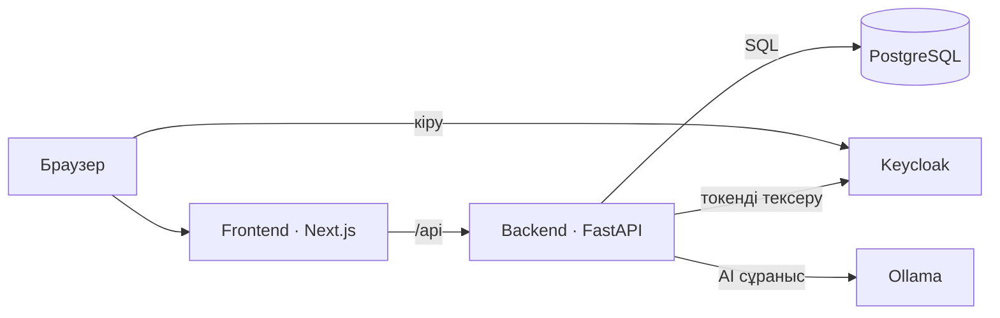

# Архитектура (6-сабақ)

Жоба — колледж мұғалімдеріне арналған онлайн тестілеу платформасы: мұғалім
тест құрады (Ollama қолдауымен), студент тапсырып, ұпайын бірден көреді.
Бір backend, бір дерекқор — **монолит** (4-сабақ). Бір адам, 8 апта:
микросервис керек емес.

## Компоненттер

| Компонент            | Не істейді                                              | Сабақ  |
|----------------------|----------------------------------------------------------|--------|
| Backend (FastAPI)    | API, ережелер, қабаттар (router → schema → service → repository → model) | 7–9    |
| PostgreSQL           | кестелер: users, quizzes, questions, attempts            | 8      |
| Keycloak             | тіркелу, кіру, рөлдер (teacher, student)                 | 10     |
| Ollama               | жергілікті LLM: сабақ мәтінінен сұрақ ұсынысы            | 13–14  |
| Frontend (Next.js)   | пайдаланушы беттері (мұғалім/студент)                    | 14     |

## Ескерту (MVP шегі)

Бастапқы қаңқадағы (4-сабақ) Redis, RabbitMQ және Worker story-лерден шықпайды —
олар MVP-ге кірмейді; 7-сабақта қажет болмаса алынып тасталады. Nginx
(кері прокси) тек локальды іске қосу үшін қалады.
