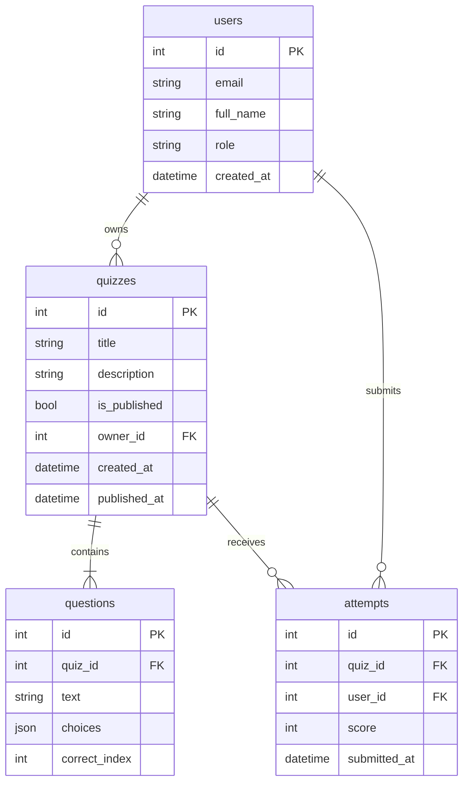

# Деректер моделі (6-сабақ)

Жоба: колледж мұғалімдеріне арналған онлайн тестілеу платформасы
(тақырып: README → «Тақырып»; story-лер: `docs/user-stories.md`).

## Кестелер (AI-сыз, өзім)

- **users**: id, email, full_name, role, created_at
  (role = `teacher` | `student`; **құпиясөз жоқ** — кіру Keycloak-та)
- **quizzes**: id, title, description, is_published, owner_id → users.id, created_at, published_at
- **questions**: id, quiz_id → quizzes.id, text, choices (JSON тізімі, 2–6 нұсқа), correct_index
- **attempts**: id, quiz_id → quizzes.id, user_id → users.id, score, submitted_at
  (студент ↔ тест көп—көп байланысының аралық кестесі)

## Байланыстар

- users 1 — көп quizzes: бір мұғалімнің көп тесті бар (owner_id)
- quizzes 1 — көп questions: бір тестте көп сұрақ бар
- users 1 — көп attempts: бір студент көп рет тапсырады
- quizzes 1 — көп attempts: бір тестті көп студент тапсырады
  (студенттер ↔ тесттер = көп—көп, аралық кесте — attempts)

## ER диаграммасы

## Story → кесте (Must)

| Story | Кесте |
|---|---|
| US-1 тест құру, сұрақ қосу | quizzes, questions |
| US-2 жариялау | quizzes |
| US-3 тапсыру, ұпай | attempts |
| US-4 AI ұсынысы | — (сақтау US-1 арқылы: questions) |
