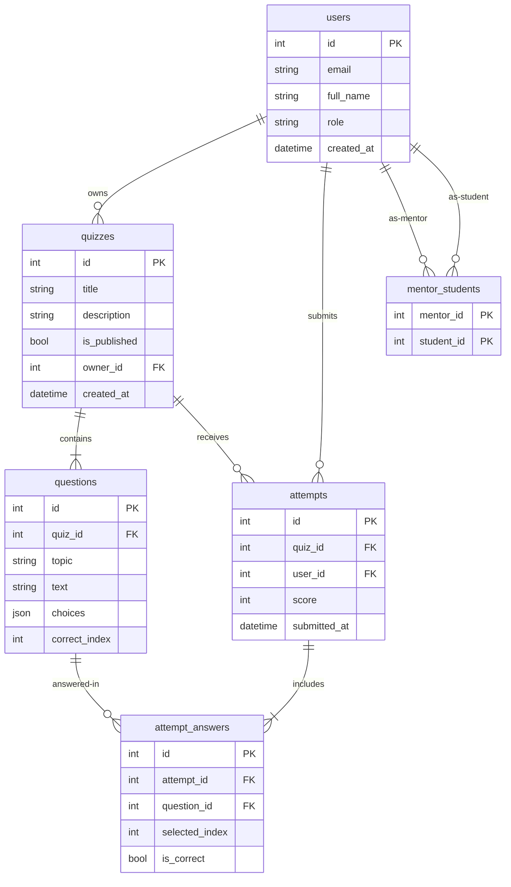

# Деректер моделі (6-сабақ)

Жоба: **TestUp AI** — ҰБТ/кешенді тестілеуге дайындалатын 18+ студенттерге
арналған AI көмекші (тақырып: README → «Тақырып»; story-лер: `docs/user-stories.md`).

## Кестелер (AI-сыз, өзім)

- **users**: id, email, full_name, role, created_at
  (role = `student` | `mentor` | `admin`; **құпиясөз жоқ** — кіру Keycloak-та)
- **quizzes**: id, title, description, is_published, owner_id → users.id, created_at
  (практикалық/пробный тест)
- **questions**: id, quiz_id → quizzes.id, topic, text, choices (JSON тізімі, 4 нұсқа), correct_index
- **attempts**: id, quiz_id → quizzes.id, user_id → users.id, score, submitted_at
  (бір студенттің бір тестті бір тапсыруы)
- **attempt_answers**: id, attempt_id → attempts.id, question_id → questions.id, selected_index, is_correct
  (әр сұраққа қалай жауап берілді — қатені талдауға керек, US-2)
- **mentor_students**: mentor_id → users.id, student_id → users.id
  (аралық кесте: ментор ↔ студент көп—көп)

## Байланыстар

- users 1 — көп quizzes: бір ментордың көп практикалық тесті бар (owner_id)
- quizzes 1 — көп questions: тест сұрақтардан тұрады
- quizzes 1 — көп attempts: бір тестті көп рет тапсырады
- users 1 — көп attempts: бір студент көп тапсырады
- attempts 1 — көп attempt_answers: бір attempt-те әр сұраққа бір жауап
- questions 1 — көп attempt_answers: сұрақ әртүрлі attempt-те жауапталады
- users (mentor) ↔ users (student) — көп—көп, аралық кесте — mentor_students

## ER диаграммасы

## Story → кесте (Must)

| Story | Кесте |
|---|---|
| US-1 тест тапсыру, ұпай | quizzes, questions, attempts, attempt_answers |
| US-2 AI қате шолуы | attempts, attempt_answers |
| US-3 әлсіз тақырыптар картасы | attempts, attempt_answers, questions |
| US-4 ментор: тест + топ + жалпы қателер | quizzes, questions, mentor_students |
