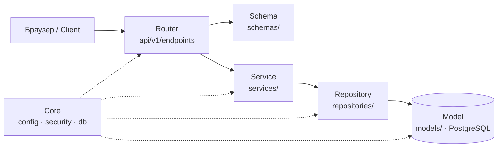

# Қабат картасы (4-сабақ)

Жоба: **AIDD Platform** — FastAPI backend, Keycloak OIDC (RBAC: student · teacher · admin),
Ollama арқылы жергілікті LLM, PostgreSQL + SQLAlchemy 2.

Бұл карта — бір сұраныстың 5 қабат арқылы жүретін жолы. Ереже: **қате неғұрлым ерте
ұсталса, соғұрлым жақсы**. Әр қабат өз ісін ғана біледі.

## Екі әрекет

| Қабат      | 1-әрекет: пайдаланушы AI мәтін генерациясын құрады | 2-әрекет: әкімші admin панелін ашады |
|------------|----------------------------------------------------|---------------------------------------|
| Router     | `POST /api/v1/llm/generate` · тек аутентификацияланған | `GET /api/v1/auth/admin/dashboard` · тек admin рөлі |
| Schema     | `GenerateRequest (prompt, model?, temperature?)` → `GenerateResponse (prompt, response, model)` | кіріс жоқ → `dict (message, access, role)` |
| Service    | тек auth-талған; Ollama-ға сұраныс, қатені 500-ке айналдырады | RBAC ережесі: `require_roles(["admin"])` — тек admin өтеді |
| Repository | DB емес — сыртқы Ollama (`llm/client.py`); дерек сақталмайды | DB сұранысы жоқ; токенді оқу; дерек `user_profiles` |
| Model      | кесте жоқ (LLM жауабы ұсап-көп емес) | `user_profiles` (id, keycloak_id, email, role, is_active) |
| Қате → HTTP | `prompt` бос/жоқ → **422**; токен жоқ/бұзылған → **401**; Ollama қатесі → **500** | рөл admin емес (мыс. student) → **403**; токен жоқ → **401** |

## Қабат → нақты файл (бұл жобада)

| Қабат | Папка | Бұл жобаның файлы |
|-------|-------|-------------------|
| Router     | `routers/` (болашақ) · қазір `api/v1/endpoints/` | `llm.py`, `auth.py`, `health.py` |
| Schema     | `schemas/` | `user.py` (`CurrentUserResponse`), LLM схемалары `llm.py`-та (8–9-сабақта `schemas/`-қа көшеді) |
| Service    | `services/` | әзірге логика router-де; 8–9-сабақта `LlmService`, `AuthService` шығады |
| Repository | `repositories/` | әзірге `db/session.py` + `llm/client.py`; 8–9-сабақта `UserRepository` |
| Model      | `models/` | `user.py` (`UserProfile` → `user_profiles` кестесі) |
| Core       | `core/` | `config.py` (.env), `security.py` (JWT/RBAC), `db/` (Base, session) |

## Біздің ереже

- Router-де SQL жоқ, business-ереже жоқ — тек endpoint + `Depends(...)` + service-ті шақыру.
- Service-те `HTTPException` жоқ — өз қатесі (мыс. `NotFoundError`), HTTP-коды router-де таңдалады.
- Schema — кіріс/шығыс пішіні мен шектеулері ғана; дерекқорға сұраныс жасамайды.
- Repository — SQL ғана (`select`, `add`, `commit`); «кімге болады» деген шешім қабылдамайды.
- Model — бағандар мен байланыстар ғана, логика жоқ.
- Құпиялар (пароль, токен, DB қосылымы) тек `.env`-те; `.env` — `.gitignore`-да, репоға түспейді.
- `.env.example` — тек атаулар мен жалған мәндер.
